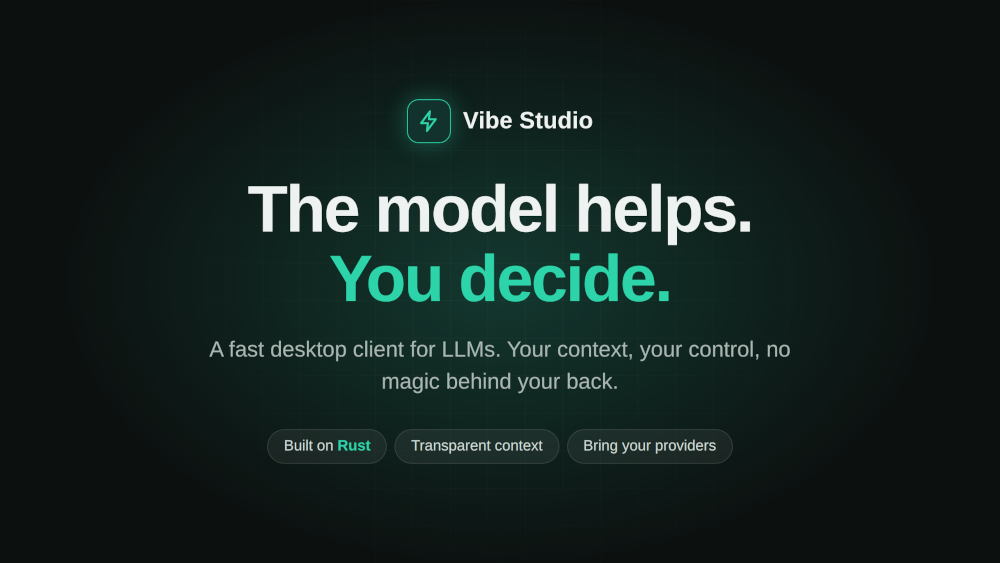

# Vibe Studio



A fast, lightweight studio for working with LLMs.

Existing LLM studios I tried are slow and overloaded. Vibe Studio is an
attempt at the opposite: a thin desktop client with a Rust backend, built
for speed. The UI is React for now — a cross-platform layer that may
eventually become fully native.

## Stack

- [Tauri 2](https://v2.tauri.app/) — desktop shell (Rust + system webview)
- Rust — backend
- React 19 + MUI 7 — UI
- Redux Toolkit, React Router, i18next (ru / en / cn)

## Status

I'm building this as a convenient tool for my own LLM work. It is
pre-alpha — far from beta, and there is a lot of work ahead.

## Run

Requires the [Tauri 2 prerequisites](https://v2.tauri.app/start/prerequisites/)
(Rust toolchain, Node.js).

```bash
npm install
npm run tauri dev
```

Packaged builds are not published yet — they will appear with the alpha.
